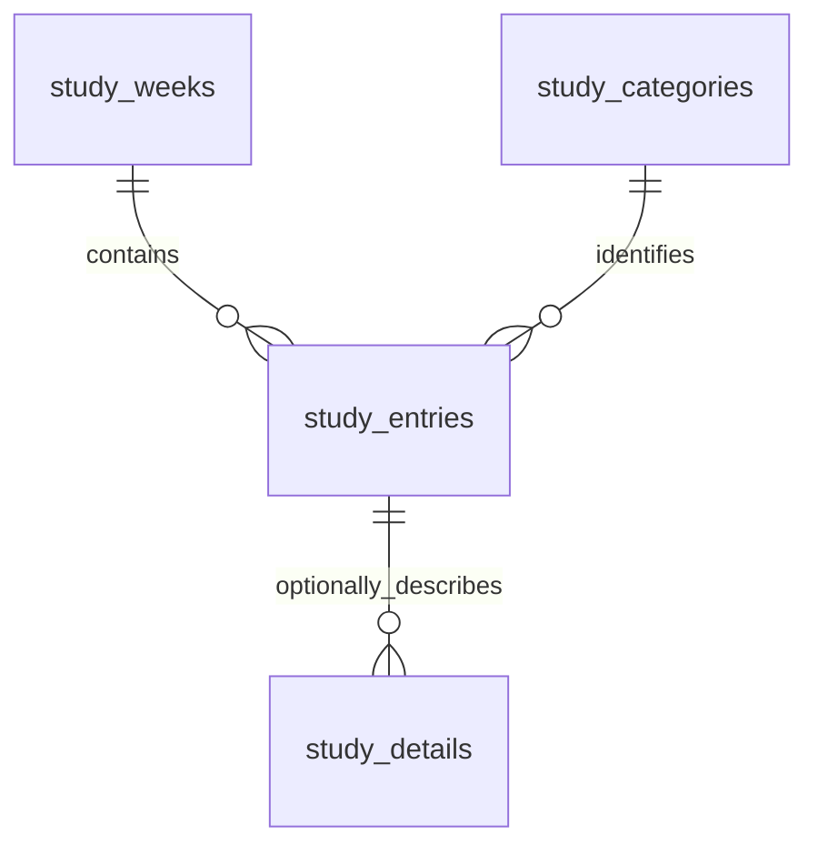

# Weekly Study Analytics — implementation and verification

Implemented locally on 2026-10-31; final edge-case review completed 2026-11-01. This module extends the existing application; it does not replace examination management. GitHub/Windows release work remains paused as requested.

## Using the feature

1. Open **Weekly Study / مطالعه هفتگی** in either operating mode.
2. Select any date in the desired week. The selector resolves to Saturday; the displayed period ends Friday in both languages.
3. Enter hours and minutes beside each category. Blank durations mean zero. Open the optional description when needed.
4. Record video time under the relevant category's **Video** disclosure. Do not include those minutes again in its main duration.
5. In Advanced Mode, enable **Use activity breakdowns** to enter labeled durations. Their sum replaces the aggregate. Quick Mode preserves those breakdowns and makes their duration read-only; other aggregates remain editable.
6. Save. Saving an existing week updates that report. Open a report from history or a chart segment to edit, delete with confirmation, copy formatted text, or download PDF, CSV or Excel.
7. Advanced Mode exposes category management, additional charts, recorded-week statistics, monthly summaries, comparisons and filtered multiweek exports. Quick Mode can reach category management through Settings.

Categories support bilingual names, description, classification, color, order and disabling. The initial 11 parents contain seven theoretical and four practical categories; Video is available under every parent, as requested. There is no standalone Video category, timer or daily/session log.

## Architecture and integrity

| Layer | Implementation |
|---|---|
| Presentation | `static/study.js`, `static/study.css`; existing navigation, settings, dialogs, fonts and calendar picker |
| API | `app/study_api.py`, mounted by `app/main.py` |
| Domain and analytics | `app/study.py` |
| Reports | `app/study_reports.py` |
| Calendar adapter | `app/calendar_localization.py`, `static/persian-calendar.json` |
| Persistence | Existing SQLite connection, transaction and restore mechanisms in `app/storage.py`; migration 3 |



- `study_weeks.week_start` is a unique Gregorian Saturday date. Dates represent civil weeks, not instants; creation/modification timestamps use the existing UTC timestamp mechanism.
- Entries have a stable category foreign key and unique `(week_start, category_id, video)` identity. Saved category names and classification are snapshots. Renaming, disabling or reclassifying never rewrites those historical facts; current colors and display order apply across history.
- Aggregate entries store integer minutes. Detailed entries store a NULL aggregate and integer-minute child facts. Read-time totals use exactly one source. No separately editable calculated totals exist.
- Revisions prevent a stale browser tab from overwriting or deleting a newer report. Conflicts return 409 and retain the local draft. Reload explicitly replaces that draft.
- Every duration must be a whole nonnegative number. Hours/minutes input uses minutes 0–59. Combined non-overlapping time cannot exceed the 10,080 minutes available in a week.
- Migration 3 is transactional and idempotent. Defaults seed once; future startup does not reset custom categories.
- Existing database backups include study records. Restore validates study schema, foreign keys, Saturday dates, duration limits and aggregate/detail exclusivity. Legacy v1/v2 backups remain supported and acquire the new empty module during migration. Restoring an old backup intentionally restores its contents; the existing recovery copy retains the pre-restore database.
- Exam JSON/CSV import/export remains examination-specific. Use full database backup/restore to transfer editable study records, categories and preferences together. Study CSV/Excel exports are reports, not a study import format.
- Demo data is confined to `tests.serve_ux` and PDF-check temporary databases. No demonstration study facts were added to the personal database.

## Analytics definitions

- Weekly totals and group totals sum integer minutes, including the parent's Video entry once.
- Stacked columns combine a category's regular and video entries. All visible categories sum to the recorded weekly total. Tooltips show exact duration and full scoped weekly total; history/report dialogs retain the video breakdown.
- The category/date filter applies to charts, statistics, monthly allocation, history totals and bulk exports. Opening a saved week displays its complete report. Legend toggles affect chart visibility only.
- Missing calendar weeks are gaps, not fabricated zero study. A saved empty report is an explicit zero-time week. For spans over ten years, only recorded weeks are plotted to bound chart size.
- Mean/median and population standard deviation describe recorded weekly totals within the filter. Standard deviation is unavailable with fewer than two observations. Zero-total shares are undefined and shown as a dash.
- Change is computed only against a recorded immediately preceding calendar week. The moving average uses the last three recorded reports (or fewer initially), not invented missing-week observations.
- Best/lowest means highest/lowest recorded time, not learning effectiveness. The interface explicitly cautions that more time does not establish better learning.
- Each whole week is assigned to the month containing its Saturday, using the selected display calendar. There is no prorating or daily estimate. Monthly totals therefore reproduce the underlying weekly facts exactly.
- Summary averages/dispersion may be fractional minutes and display rounded to the nearest minute. Saved totals remain exact integers.

## Research and technical choices

| Approach | Decision and rationale |
|---|---|
| Existing Apache ECharts | Retained: native stacked columns, zoom, interactive legend, canvas rendering, themes, keyboard-readable data tables and non-color pattern distinctions already exist in the application. No second chart library is necessary. [Official stacked-bar documentation](https://echarts.apache.org/handbook/en/how-to/chart-types/bar/stacked-bar/) |
| Existing SQLite | Retained: one local database, relational constraints, transactional migration and validated backups suit weekly aggregates. [SQLite schema changes](https://www.sqlite.org/lang_altertable.html) |
| Browser Intl Persian calendar | Retained as the calendar authority. A cross-runtime comparison found a one-day difference in Persian year 1503 between the candidate Python `jdatetime` library and existing Intl. The Python dependency was removed. A small generated year-start table now lets server monthly grouping and exports follow the existing browser calendar. [ICU calendars](https://unicode-org.github.io/icu/userguide/datetime/calendar/), [candidate library](https://github.com/slashmili/jdatetime) |
| Chromium PDF through Playwright | Native Persian shaping, bidi and embedded local Vazirmatn produce actual downloadable PDFs, including category stacks. The generated HTML escapes user data and blocks external requests. [Official PDF API](https://playwright.dev/python/docs/api/class-page#page-pdf) |
| openpyxl Excel export | Numeric-minute cells, RTL sheet layout and editable stacked-column charts. Category series use the configured colors. Formula-like user text is neutralized in both spreadsheet export formats. [Official documentation](https://openpyxl.readthedocs.io/en/stable/tutorial.html) |

Calendar range matches existing Jalali input: years 1200–1600. Complete study weeks must fit within that interval, including when selected in English. Year-start data is generated with `node scripts/build_calendar_data.cjs`; use `--check` to detect ICU drift. The cross-runtime test compares 20,924 dates throughout the range. Regeneration requires reviewing any changes, not blindly accepting a new calendar dataset.

## API contracts

| Method | Route | Behavior |
|---|---|---|
| GET / POST | `/api/study/categories` | List all categories including disabled / create custom category |
| PATCH | `/api/study/categories/{id}` | Edit metadata without changing historical entry snapshots |
| GET | `/api/study/weeks/{date}` | Normalize date to Saturday; return saved report or revision-0 draft |
| PUT | `/api/study/weeks/{date}` | Replace the week's entries transactionally; requires current `revision` |
| DELETE | `/api/study/weeks/{date}?revision=N` | Delete only the matching report revision |
| GET | `/api/study/analytics` | Optional `from_date`, `to_date`, `category_id`, `calendar=gregorian|persian` |
| GET | `/api/study/export` | Same scope, `format=text|csv|xlsx|pdf`, `language=en|fa`, `digits=native|latin` |

Example PUT body (aggregate and optional detail sources):

```json
{"revision":0,"notes":"Weekly review","entries":[
  {"category_id":1,"minutes":210,"description":"Practice"},
  {"category_id":9,"video":true,"minutes":45},
  {"category_id":7,"details":[{"label":"Course 31","minutes":225},{"label":"Course 32","minutes":45}]}
]}
```

Validation errors use localized `study...` codes; invalid input is 422, missing export data is 404 and revision conflicts are 409. PDF batches are limited to 52 weeks. Invalid text control characters are rejected so saved content remains exportable.

Revision tokens are opaque, globally increasing values, not per-week counters. Always submit the token returned by GET/PUT; do not assume a new saved report has revision 1. A persisted internal counter prevents token reuse after deletion. Restoring a backup issues fresh tokens, so a draft opened before restoration cannot overwrite restored records. This metadata does not change saved study durations, categories or timestamps.

## Setup and verification

Install the updated `requirements.txt`. PDF generation uses installed Microsoft Edge on Windows if Playwright Chromium is absent. For other environments, or an explicit bundled browser installation:

```powershell
python -m playwright install chromium
```

No browser download is required for normal data entry, charts, CSV or Excel. If no usable browser is installed, PDF export returns a localized setup message. This Windows environment was tested with Microsoft Edge.

```powershell
python -m unittest discover -s tests -q
node --test tests/frontend.test.cjs tests/statistics.test.cjs tests/locale.test.cjs tests/study.test.cjs
node scripts/build_calendar_data.cjs --check
python -m tests.check_study_pdf
python -m tests.serve_ux
# In a separate terminal, after opening localhost:8002 with Playwright CLI:
npx --yes --package @playwright/cli playwright-cli run-code --filename tests/study-browser.cjs
```

Historical feature-delivery results (2026-11-01; superseded by [current verification](remediation-2026-11-02/validation.md)):

- 50 Python tests passed, including 12 new study tests; existing scoring, API, persistence and restore tests remain green.
- 18 Node tests passed, including study boundaries, numeral handling, translation parity, missing-week semantics and cross-runtime calendar agreement.
- 24 study browser combinations: Quick/Advanced × English/Persian × Light/Dark × 390/768/1440 px. No page errors or horizontal overflow; local Persian font, chart segment sums and accessible duration units checked.
- Browser workflows: weekly creation/update, Saturday normalization, aggregate-to-detail conversion, multiple detail rows, Video, Quick preservation of advanced details, Persian numerals, Jalali selection, invalid-duration recovery, category creation, filtering, comparison views and CSV download.
- `tests/study-exports-browser.cjs` additionally passed actual chart-segment hit testing, CSV/Excel/PDF downloads, copy-text feedback, revision-conflict draft preservation, reload confirmation and confirmed report deletion. Its native confirmations are handled with Playwright CLI `dialog-accept`; `window.studyExportQA` exposes the final assertions. The intentionally injected 409 response appears in the browser network console; no JavaScript page errors occurred.
- Existing `tests/ux-pages.cjs` passed its 12 language/theme/viewport configurations, covering examination details/edit dialogs, focus restoration, analytics, subjects, reports, settings and retry after a deliberately failed request.
- Actual English/Persian PDF responses generated from temporary example data. Both rendered to one A4 page and were visually inspected with Poppler; fonts, RTL, mixed-script descriptions, chart, totals and page footer are legible. See `outputs/study/weekly-en.pdf` and `weekly-fa.pdf`.
- At that checkpoint Starlette/httpx emitted a non-failing deprecation warning and the Windows build was not verified. The current pinned environment removes that warning; local frozen/native study and PDF tests now pass. GitHub publication remains paused.

## Operational limits

The existing application remains single-user and loopback-only; use one server worker. Statistical summaries describe recorded time, not quality of learning. Multi-year chart/filter and export work is synchronous in server worker threads; no unnecessary analytics cache or AI service is introduced. Very long activity descriptions can make a PDF span multiple pages. Excel references Vazirmatn by name; install the font for matching typography in external spreadsheet viewers, while PDF embeds it directly.

### Final edge-case review — 2026-11-01

`tests/study-edge-browser.cjs` verifies empty-history feedback, saved zero-week charts, undefined zero-total shares, hidden zero-duration report rows, disabled-category history, original classification after renaming/reclassification, and unsaved draft retention across navigation. A delayed report-response race was fixed using the existing request-version mechanism; both stale successful responses and stale errors are ignored after navigation. All edge-case browser checks passed without page errors.
